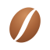
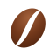
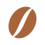
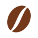
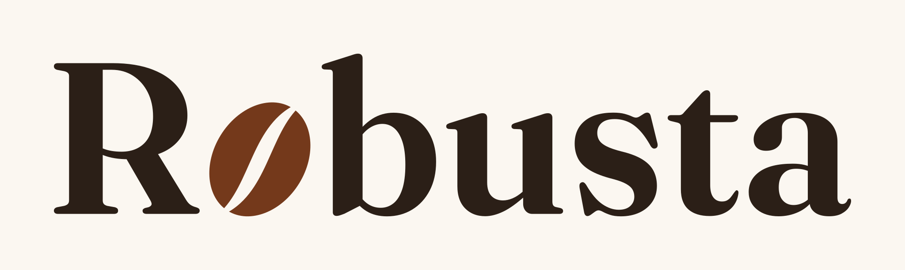
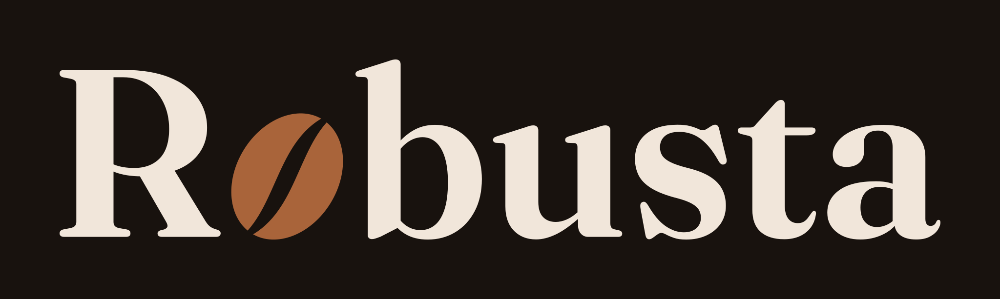

# Branding Assets for [Robusta](https://github.com/robusta-rs/robusta)

## Icons

### Color

| Light | Dark |
|:-----:|:----:|
|  |  |
| [SVG](icon-color-light.svg) / [PNG](icon-color-light.png) | [SVG](icon-color-dark.svg) / [PNG](icon-color-dark.png) |

### Flat

| Light | Dark |
|:-----:|:----:|
|  |  |
| [SVG](icon-flat-light.svg) / [PNG](icon-flat-light.png) | [SVG](icon-flat-dark.svg) / [PNG](icon-flat-dark.png) |

### Mono

| Light | Dark |
|:-----:|:----:|
|  |  |
| [SVG](icon-mono-light.svg) / [PNG](icon-mono-light.png) | [SVG](icon-mono-dark.svg) / [PNG](icon-mono-dark.png) |

## Logos

### Color

| Light | Dark |
|:-----:|:----:|
|  |  |
| [SVG](logo-color-light.svg) / [PNG](logo-color-light.png) | [SVG](logo-color-dark.svg) / [PNG](logo-color-dark.png) |

### Flat

| Light | Dark |
|:-----:|:----:|
|  |  |
| [SVG](logo-flat-light.svg) / [PNG](logo-flat-light.png) | [SVG](logo-flat-dark.svg) / [PNG](logo-flat-dark.png) |

### Mono

| Light | Dark |
|:-----:|:----:|
|  |  |
| [SVG](logo-mono-light.svg) / [PNG](logo-mono-light.png) | [SVG](logo-mono-dark.svg) / [PNG](logo-mono-dark.png) |

## Special Variants

### Favicon

Use for favicons. It follows the browser's light or dark theme.

| | |
|:-----:|:----:|
|  | |
| [SVG](favicon.svg) | |

### Background

| Cream | Espresso |
|:-----:|:--------:|
|  |  |
| [SVG](icon-cream-bg.svg) / [PNG](icon-cream-bg.png) | [SVG](icon-espresso-bg.svg) / [PNG](icon-espresso-bg.png) |
|  |  |
| [SVG](logo-cream-bg.svg) / [PNG](logo-cream-bg.png) | [SVG](logo-espresso-bg.svg) / [PNG](logo-espresso-bg.png) |
